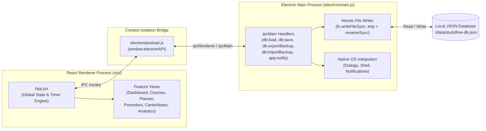

# StudyFlow — Desktop Study Planner & Focus Studio

**StudyFlow** is a standalone, 100% offline-capable local desktop application built with **Electron**, **React 18**, **Vite**, and **Tailwind CSS**. It combines syllabus management, daily/weekly time-blocked scheduling, a linked Pomodoro focus timer, SM-2 spaced repetition flashcards, revision notes, and study analytics into a single workspace.

---

## Table of Contents

1. [Key Features](#1-key-features)
2. [Tech Stack & Architecture](#2-tech-stack--architecture)
3. [Project Directory Structure](#3-project-directory-structure)
4. [Getting Started & Installation](#4-getting-started--installation)
5. [Detailed Feature Guide](#5-detailed-feature-guide)
   - [Dashboard Command Center](#51-dashboard-command-center)
   - [Courses, Syllabus & Topic Breakdown](#52-courses-syllabus--topic-breakdown)
   - [Daily & 7-Day Weekly Study Planner](#53-daily--7-day-weekly-study-planner)
   - [Pomodoro Focus Studio & Offline Logger](#54-pomodoro-focus-studio--offline-logger)
   - [Spaced Repetition Flashcards (SM-2) & Study Notes](#55-spaced-repetition-flashcards-sm-2--study-notes)
   - [Study Analytics & Consistency Heatmap](#56-study-analytics--consistency-heatmap)
   - [Settings, Backups & Resetting Data](#57-settings-backups--resetting-data)
6. [Local Database & IPC Specification](#6-local-database--ipc-specification)
   - [Storage Location & Atomic Writes](#61-storage-location--atomic-writes)
   - [Electron IPC Channels](#62-electron-ipc-channels)
   - [JSON Database Schema](#63-json-database-schema)
7. [Customization & Development Guide](#7-customization--development-guide)
8. [Troubleshooting](#8-troubleshooting)

---

## 1. Key Features

- **100% Local & Private Persistence**: Automatically saves all changes to `./data/studyflow-db.json` using atomic file writes (write to `.tmp` then rename) with automatic `localStorage` fallback.
- **Hierarchical Course & Syllabus Tracking**: Organize subjects by course code, color theme, target study hours, and exam dates. Break each course into modules and topics with status cycling (`Not Started` → `In Progress` → `Mastered`), 1–5 star confidence ratings, and logged vs. estimated minutes.
- **7-Day Weekly Calendar & Task Planner**: Plan study blocks by date and time slot (`Start Time – End Time`), filter by `Today`, `Upcoming`, `Overdue`, or `Completed`, and launch a focus session directly from any task.
- **Persistent Linked Pomodoro Timer**: Runs globally across tabs with a live mini-player in the sidebar. Links focus sessions to a specific **Course**, **Topic**, and **Task**—automatically updating topic hours, marking linked tasks complete, extending your daily streak, and playing an offline Web Audio chime + native desktop notification.
- **SM-2 Spaced Repetition Flashcards**: Active recall flashcard reviewer with hints and 4 rating levels (`Again`, `Hard`, `Good`, `Easy`) that dynamically calculate each card's ease factor and next review date.
- **Course Revision Notes**: Split-pane note editor with instant search, course filtering, and pinned summary sheets.
- **Visual Study Analytics**: 14-day daily study output bar chart, course time distribution breakdown, 28-day study consistency heatmap, and full session log history.

---

## 2. Tech Stack & Architecture

| Layer | Technology | Purpose |
| :--- | :--- | :--- |
| **Desktop Shell** | Electron `22.x` | Native window management, filesystem persistence, native file dialogs, OS notifications |
| **Frontend UI** | React `18.x` | Component-driven UI, global Pomodoro timer state, reactive data synchronization |
| **Build Tool** | Vite `4.x` | Fast ESM bundling and production asset compilation (`./dist`) |
| **Styling** | Tailwind CSS `3.x` | Dark-slate desktop theme, responsive grid layouts, custom scrollbars |
| **Icons** | Lucide React | Clean vector iconography across navigation and metrics |
| **Audio Engine** | Web Audio API | Zero-dependency synthesized completion chime (works completely offline) |

### System Architecture Diagram



---

## 3. Project Directory Structure

```text
study-planner/
├── Launch-StudyFlow.bat           # One-click Windows launcher script
├── package.json                   # Project dependencies and build/start scripts
├── vite.config.js                 # Vite bundler config (relative base './' for Electron)
├── tailwind.config.js             # Tailwind CSS theme and content scanning setup
├── postcss.config.js              # PostCSS plugins (tailwindcss, autoprefixer)
├── index.html                     # HTML shell entry point
├── data/
│   └── studyflow-db.json          # Auto-generated local JSON database file (gitignored)
├── dist/                          # Compiled production frontend assets (gitignored)
├── electron/
│   ├── main.js                    # Electron main process, window creation & IPC handlers
│   └── preload.js                 # Secure contextBridge exposing window.electronAPI
└── src/
    ├── main.jsx                   # React DOM root mounting
    ├── index.css                  # Tailwind directives & custom scrollbar rules
    ├── App.jsx                    # Application shell, sidebar, global timer & auto-save
    ├── data/
    │   └── initialData.js         # Date utilities, SM-2 algorithm, Web Audio chime & starter data
    └── components/
        ├── DashboardView.jsx      # Daily overview, KPIs, today's agenda & exam countdowns
        ├── CoursesView.jsx        # Course CRUD, syllabus topic breakdown & confidence stars
        ├── PlannerView.jsx        # 7-day weekly calendar grid & filtered task list
        ├── PomodoroView.jsx       # Circular SVG countdown timer & manual session logger
        ├── FlashcardsNotesView.jsx# SM-2 flashcard deck reviewer & split-pane study notes
        ├── AnalyticsView.jsx      # 14-day bar chart, course distribution & 28-day heatmap
        └── SettingsModal.jsx      # Goal/timer settings, JSON backup export/import & data reset
```

---

## 4. Getting Started & Installation

### Prerequisites
- **Node.js** (v16.15+ or v18+ / v20+) and **npm** installed on your system.

### Installation

```bash
# 1. Clone the repository
git clone https://github.com/Moaz-Helmy/study-planner.git
cd study-planner

# 2. Install dependencies
npm install

# 3. Build the production frontend bundle
npm run build

# 4. Launch the desktop app
npm start
```

### Windows One-Click Launch
On Windows, you can double-click **`Launch-StudyFlow.bat`** in the project root directory to build (if needed) and launch the desktop app directly. You can also right-click `Launch-StudyFlow.bat` and select **Send to → Desktop (create shortcut)** for quick access.

---

## 5. Detailed Feature Guide

### 5.1 Dashboard Command Center
Located in `src/components/DashboardView.jsx`:
- **Today's Focus KPI**: Shows minutes studied today vs. your configurable daily goal (`120m` default) with a progress bar.
- **Study Streak**: Calculates consecutive days with at least one logged study session (`calculateStreak()` in `src/data/initialData.js`).
- **Topic Mastery**: Displays the ratio and percentage of syllabus topics marked `Mastered` across all courses.
- **Due Flashcards**: Shows how many flashcards have `nextReviewDate <= today` and navigates directly to the reviewer when clicked.
- **Today's Study Agenda**: Lists all tasks scheduled for today (plus any uncompleted overdue tasks). Click the circle icon to mark a task complete, or click **Focus** to immediately start a Pomodoro session linked to that task.
- **Upcoming Exam Countdowns**: Highlights the next 3 courses with upcoming exam dates and displays the exact number of days remaining.

### 5.2 Courses, Syllabus & Topic Breakdown
Located in `src/components/CoursesView.jsx`:
- **Creating & Editing Courses**: Click **New Course / Subject** to set the Course Title, Course Code (e.g., `CS-301`), Target Study Hours, Exam Date, Theme Color (`Indigo`, `Emerald`, `Amber`, `Rose`, `Cyan`, `Violet`), and syllabus notes.
- **Managing Syllabus Topics**: Select any course on the left to manage its topics on the right:
  - Add topics with a **Title**, **Module/Unit** label, and **Estimated Minutes**.
  - **Cycle Mastery Status**: Click a topic's status badge to cycle `Not Started` → `In Progress` → `Mastered`.
  - **Confidence Rating**: Click the 1–5 star icons on any topic to rate your current exam readiness.
  - **Quick Time Logging**: Click `+30m` on any topic to immediately log a 30-minute study session for that course and topic, or click **Focus** to open the Pomodoro timer pre-linked to that topic.

### 5.3 Daily & 7-Day Weekly Study Planner
Located in `src/components/PlannerView.jsx`:
- **Schedule Form**: Create time-blocked study tasks linked to a specific Course and Topic, with a scheduled Date, Start/End Time (`18:00 – 19:00`), Estimated Minutes, and Priority (`High`, `Medium`, `Low`).
- **7-Day Calendar Grid View**:
  - Displays 7 day columns side-by-side with total planned duration per day.
  - Use `<` / `Starting Today` / `>` buttons to navigate across weeks.
  - Click any day header or `+ Schedule` placeholder to pre-fill the task form with that date.
- **Task List View**: Filter all scheduled tasks by `Today`, `Upcoming`, `Overdue`, `Completed`, or `All Tasks`.

### 5.4 Pomodoro Focus Studio & Offline Logger
Located in `src/components/PomodoroView.jsx` and `src/App.jsx`:
- **Global Persistent Timer**: The countdown timer runs inside `App.jsx`, meaning you can freely switch to your Study Notes, Flashcards, or Syllabus while the timer ticks in the background (visible in the left sidebar mini-player).
- **Modes**: Switch between **Focus** (default `25m`), **Short Break** (`5m`), and **Long Break** (`15m`). All durations are customizable in **Settings**.
- **Course, Topic & Task Linking**:
  - Select which Course and Topic you are studying during the current focus block.
  - When the timer reaches `00:00` (or when you click **Log Session** early):
    1. Plays a synthesized 4-note harmonic chime (`C5 → E5 → G5 → C6`) via the Web Audio API.
    2. Fires a native desktop notification via Electron.
    3. Appends a new session entry to `data.sessions`.
    4. Increments `loggedMinutes` on the selected Topic (and automatically advances its status from `Not Started` to `In Progress`).
    5. Marks any linked Planner Task as `completed: true`.
- **Log Offline / Manual Study Session**: Use the form on the right side of the Pomodoro view to record study sessions completed away from your computer (e.g., library reading, handwritten problem sets, or labs).

### 5.5 Spaced Repetition Flashcards (SM-2) & Study Notes
Located in `src/components/FlashcardsNotesView.jsx`:
- **Flashcards Sub-Tab**:
  - Filter cards by Course or review across **All Courses**.
  - Toggle between **Due for Review Today** and **Practice All Cards in Deck**.
  - Click the flashcard to flip between **Front (Question)** and **Back (Answer)**, or click **Show Hint** before flipping.
  - **SM-2 Rating Buttons** (`computeNextFlashcardReview` in `src/data/initialData.js`):
    - **Again**: Resets `repetitions = 0`, sets `interval = 1 day`, and reduces `easeFactor` by `0.2` (minimum `1.3`).
    - **Hard**: Scales `interval` by `1.2x` and reduces `easeFactor` by `0.15`.
    - **Good**: Sets `interval` to `1d` (1st review), `3d` (2nd review), or `round(interval * easeFactor)` for subsequent reviews.
    - **Easy**: Sets `interval` to `4d` (1st review), `7d` (2nd review), or `round(interval * easeFactor * 1.3)` and increases `easeFactor` by `0.15` (up to `3.0`).
- **Study Notes Sub-Tab**:
  - Create, edit, pin, and delete structured revision notes per course.
  - Instant search filters notes by title, content, or tags.

### 5.6 Study Analytics & Consistency Heatmap
Located in `src/components/AnalyticsView.jsx`:
- **KPI Summary**: Total hours studied, current streak, 14-day daily average vs. goal, and syllabus topics mastered.
- **Last 14 Days Study Output Bar Chart**: Visualizes daily study minutes over the past two weeks. Bars turn emerald green on days where you meet or exceed your daily study goal.
- **Time Allocation by Course**: Horizontal progress bars showing total hours and percentage of study time spent on each subject.
- **28-Day Consistency Grid**: A 4-week heatmap grid shaded by daily study intensity (`0m`, `1–59m`, `60–119m`, `120m+`).
- **Complete Study Session History**: Full chronological log table with the ability to delete any session entry recorded by mistake.

### 5.7 Settings, Backups & Resetting Data
Click **Settings & Data Backup** at the bottom of the left sidebar (`src/components/SettingsModal.jsx`):
- Customize your **Display Name**, **Daily Study Goal (Minutes)**, and **Pomodoro Focus / Short Break / Long Break** durations.
- Toggle the completion audio chime on or off.
- **Open Data Folder**: Opens your system file manager highlighting `./data/studyflow-db.json`.
- **Export JSON Backup**: Opens a native Save dialog to save a timestamped `.json` backup anywhere on your machine.
- **Import Backup**: Opens a native Open dialog to restore a previously exported `.json` file.
- **Restore Starter Sample Data** / **Clear All Data (Start Blank)**: Reset to the initial sample dataset or wipe all courses/tasks/sessions to begin with a clean slate.

---

## 6. Local Database & IPC Specification

### 6.1 Storage Location & Atomic Writes
All user data is stored locally relative to the application directory at:
```text
./data/studyflow-db.json
```
Whenever state changes in React (`App.jsx`), the app invokes `window.electronAPI.saveData(data)`. In `electron/main.js`, `writeDatabase()` writes the formatted JSON to `studyflow-db.json.tmp` first and then atomically renames it to `studyflow-db.json` so the file cannot be corrupted by an unexpected power loss or crash.

### 6.2 Electron IPC Channels
Defined in `electron/main.js` and exposed via `electron/preload.js`:

| IPC Channel | Preload Method | Description |
| :--- | :--- | :--- |
| `db:load` | `window.electronAPI.loadData()` | Reads `./data/studyflow-db.json` and returns `{ data, dbPath }` |
| `db:save` | `window.electronAPI.saveData(data)` | Atomically writes the state object to `./data/studyflow-db.json` |
| `db:getPath` | `window.electronAPI.getDbPath()` | Returns the resolved path to `studyflow-db.json` |
| `db:revealInFolder` | `window.electronAPI.revealDbInFolder()` | Opens the host file explorer highlighting `studyflow-db.json` |
| `db:exportBackup` | `window.electronAPI.exportBackup(data)` | Opens native Save Dialog and writes a backup `.json` file |
| `db:importBackup` | `window.electronAPI.importBackup()` | Opens native Open Dialog, parses `.json`, and updates the database |
| `app:notify` | `window.electronAPI.notify({ title, body })` | Displays a native OS desktop notification |

### 6.3 JSON Database Schema

```json
{
  "settings": {
    "userName": "Scholar",
    "dailyGoalMinutes": 120,
    "pomodoroFocusMinutes": 25,
    "pomodoroShortBreakMinutes": 5,
    "pomodoroLongBreakMinutes": 15,
    "soundEnabled": true
  },
  "courses": [
    {
      "id": "course-1",
      "title": "Algorithms & Data Structures",
      "code": "CS-301",
      "color": "indigo",
      "targetHours": 40,
      "examDate": "2026-11-03",
      "description": "Graph algorithms, dynamic programming, trees, and complexity analysis.",
      "topics": [
        {
          "id": "topic-101",
          "title": "Binary Search Trees & AVL Balancing",
          "module": "Module 1: Trees",
          "status": "Mastered",
          "priority": "High",
          "estimatedMinutes": 90,
          "loggedMinutes": 95,
          "confidence": 5
        }
      ]
    }
  ],
  "tasks": [
    {
      "id": "task-1",
      "title": "Solve 3 DP problems on Tabulation vs Memoization",
      "courseId": "course-1",
      "topicId": "topic-103",
      "date": "2026-10-16",
      "startTime": "17:30",
      "endTime": "18:30",
      "estimatedMinutes": 60,
      "priority": "High",
      "completed": false,
      "notes": "Focus on state transition equations."
    }
  ],
  "sessions": [
    {
      "id": "sess-1",
      "courseId": "course-1",
      "topicId": "topic-102",
      "date": "2026-10-16",
      "durationMinutes": 50,
      "mode": "Focus",
      "notes": "Reviewed Dijkstra implementation.",
      "timestamp": "2026-10-16T14:15:00.000Z"
    }
  ],
  "flashcards": [
    {
      "id": "card-1",
      "courseId": "course-1",
      "front": "When does Dijkstra's algorithm fail?",
      "back": "When the graph contains negative-weight edges; use Bellman-Ford instead.",
      "hint": "Think about edge weights.",
      "repetitions": 1,
      "interval": 1,
      "easeFactor": 2.5,
      "lastReviewed": "2026-10-15",
      "nextReviewDate": "2026-10-16"
    }
  ],
  "notes": [
    {
      "id": "note-1",
      "courseId": "course-1",
      "title": "Dynamic Programming Study Checklist",
      "pinned": true,
      "tags": ["DP", "Exam-Prep"],
      "updatedAt": "2026-10-16",
      "content": "1. Define state parameters..."
    }
  ]
}
```

---

## 7. Customization & Development Guide

- **Adding Course Color Themes**: Edit `COURSE_COLORS` in `src/data/initialData.js` to add new Tailwind color palettes.
- **Modifying Starter Sample Data**: Edit `createInitialData()` in `src/data/initialData.js`.
- **Changing Window Dimensions**: Edit `width`, `height`, `minWidth`, and `minHeight` inside `createWindow()` in `electron/main.js`.
- **Rebuilding After UI Changes**:
  ```bash
  npm run build
  npm start
  ```

---

## 8. Troubleshooting

1. **Electron exits immediately when launched from inside an Electron-based IDE terminal (e.g., VS Code)**:
   - Electron-based IDEs sometimes set `ELECTRON_RUN_AS_NODE=1` in child terminals, which causes `electron` to run as a plain Node.js process instead of opening a GUI window.
   - **Solution**: Clear the variable before launching (`set "ELECTRON_RUN_AS_NODE="` in CMD, `Remove-Item Env:ELECTRON_RUN_AS_NODE` in PowerShell, or `unset ELECTRON_RUN_AS_NODE` in bash/zsh), or use `Launch-StudyFlow.bat` on Windows which clears it automatically.
